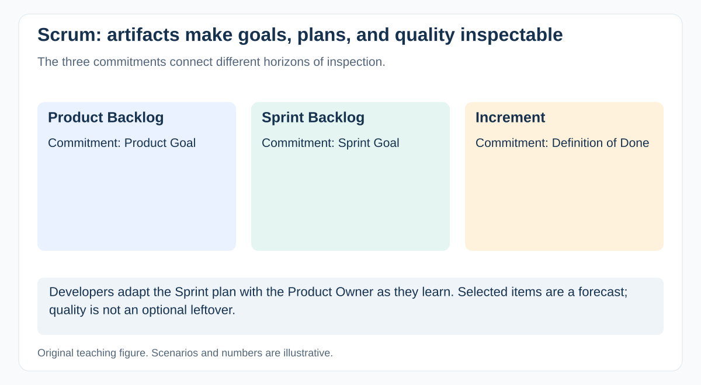

# How do Product Goal, Sprint Goal, and the two Scrum backlogs relate?

[Back to questions](../../README.md#agile-scrum-and-kanban)

**Level:** Middle · **Topic:** Agile, Scrum, and Kanban · **Reviewed:** 2026-10-30

## Answer

The Product Goal gives the Scrum Team a longer-term objective. The ordered Product Backlog evolves toward that objective. A Sprint Goal focuses a Sprint, and the Sprint Backlog contains the selected items and Developers' plan for achieving that goal.

For example, a product goal might concern reliable self-service refunds, while a Sprint Goal enables one supported refund path. Treat the selected work as a forecast and adapt with the Product Owner as learning occurs. Copying an entire project schedule into a Sprint Backlog obscures its immediate purpose. Goals should enable coherent choices when an item proves larger than expected.

## Connect each artifact to its commitment

The Scrum commitments are Product Goal for the Product Backlog, Sprint Goal for the Sprint Backlog, and Definition of Done for the Increment. This makes progress and quality inspectable at different horizons.

For refunds, a Sprint Goal might be “a support agent can safely initiate an eligible refund.” If one selected item expands, Developers and the Product Owner can adjust scope while preserving that goal. A goal such as “complete tickets 12–18” gives less guidance for a trade-off.

An Increment is a usable step toward the Product Goal and may be created more than once in a Sprint. Backlog refinement is ongoing activity; Scrum does not define a separate mandatory refinement event or Definition of Ready.

## References

- [The Scrum Guide (2020)](https://scrumguides.org/scrum-guide.html)
