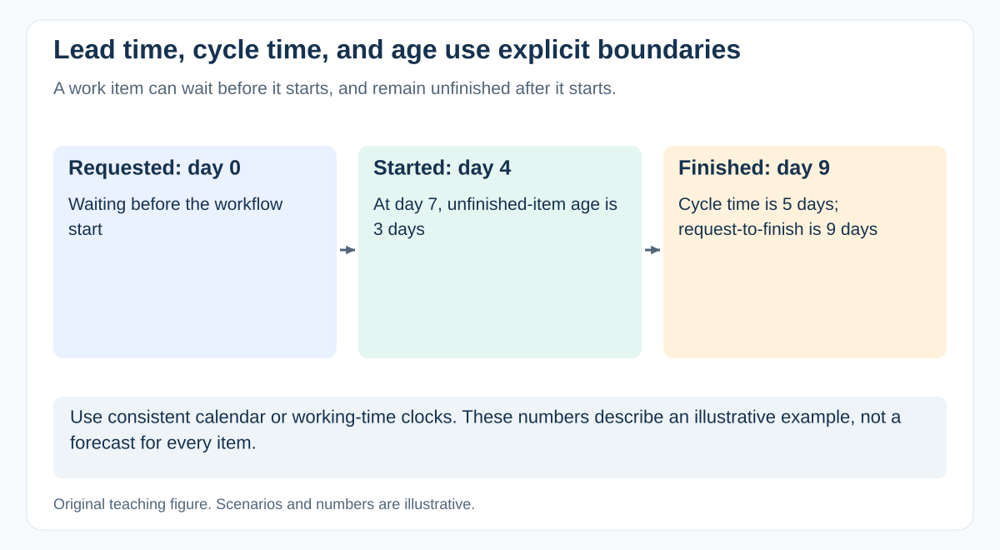

# How do cycle time, throughput, WIP, and work item age differ?

[Back to questions](../../README.md#agile-scrum-and-kanban)

**Level:** Middle · **Topic:** Agile, Scrum, and Kanban · **Reviewed:** 2026-10-30

## Answer

Cycle time measures elapsed time between the workflow's defined start and finish. Throughput counts completed items per time period. WIP counts started but unfinished items. Work item age measures elapsed time since a current item started.

Use consistent boundaries and inspect distributions, blocked work, and outliers. If an item is older than most historical completions, investigate it before it disappears in an average. A request-to-delivery lead time may include waiting before work starts, so define that separately. Avoid comparing teams with different item sizes or boundaries. Faster ticket movement is useful only if quality and user outcomes remain healthy.

## Calculate an example

An item starts Monday morning and finishes Thursday morning: its cycle time is three calendar days if that is the team's stated clock. An unfinished item started Tuesday is two days old on Thursday. Five completions in a week give throughput of five items per week. State whether weekends and pauses are included.

A service level expectation can use a historical percentile, such as “85 percent of comparable items finished within eight days.” That is an evidence-based expectation, not a promise that every item will do so.

Little's Law relates average WIP, throughput, and cycle time for a stable system with consistent boundaries. Use it as a diagnostic relationship under its assumptions, not as a guaranteed formula for reducing a particular item's duration.

## References

- [MIT 1.041: queueing models and Little's Law](https://web.mit.edu/1.041/www/lectures/L8-queuing-models-2026sp.pdf)
- [The Kanban Guide (May 2025)](https://kanbanguides.org/the-kanban-guide/2025.5/)
