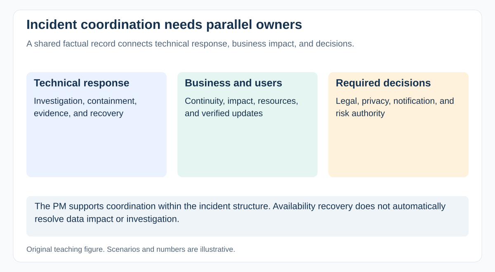

# What is the PM's role during a suspected security incident?

[Back to questions](../../README.md#cybersecurity-domain)

**Level:** Senior · **Topic:** Cybersecurity Domain · **Reviewed:** 2026-10-30

## Answer

Activate the established response process and establish **who directs the incident, who investigates and contains it, who communicates, and who makes business decisions**. The PM can support coordination without taking technical command by default.

## Use the current response context

NIST **SP 800-61 Rev. 3**, final April 2025, supersedes Rev. 2 and integrates incident response with CSF 2.0 risk management. Preparation spans governance, asset/risk understanding, and protection; detection, response, and recovery depend on those capabilities. Do not present the older four-phase model as the latest NIST publication.

## Coordinate without damaging evidence

Establish a restricted record of facts, impact, hypotheses, decisions, actions, and times. Separate known information from assumptions. Follow qualified responders' instructions for evidence handling, containment, access, and communications.

| Decision area | Relevant owner or role |
| --- | --- |
| Technical investigation and containment | Incident commander and specialist responders |
| Service continuity and user impact | Service and business owners |
| Notification duties | Legal, privacy, compliance, and authorized communications |
| Resources, dependencies, follow-through | Coordinators including a PM where assigned |

Rebooting systems, deleting records, or applying an unplanned fix can destroy evidence or alter exposure. The PM should obtain the necessary decision rather than independently prescribing forensic actions.

## Example: suspicious privileged access

Responders may need to restrict an account while operations assesses service impact and communications prepares verified updates. Coordinate those workstreams, ensure urgent approvals and support access are available, and record who authorized the chosen action.

Notification clocks, triggers, recipients, and content depend on applicable rules and facts. Do not treat one generic “72-hour breach rule” as universal.

## Recover and learn

Agree evidence for restoration, integrity, access review, continued monitoring, and remaining exposure. Restoring availability does not automatically end investigation or resolve affected-data consequences.

Assign post-incident actions with owners and verification. Feed lessons into asset visibility, supplier arrangements, rehearsals, and release/readiness decisions. The PM's value is reliable coordination and closure of actions, not speculative attribution.

## References

- [NIST SP 800-61 Rev. 3: current final incident-response recommendations](https://csrc.nist.gov/pubs/sp/800/61/r3/final)
- [Google SRE Workbook: incident-command and coordination practices](https://sre.google/workbook/incident-response/)
