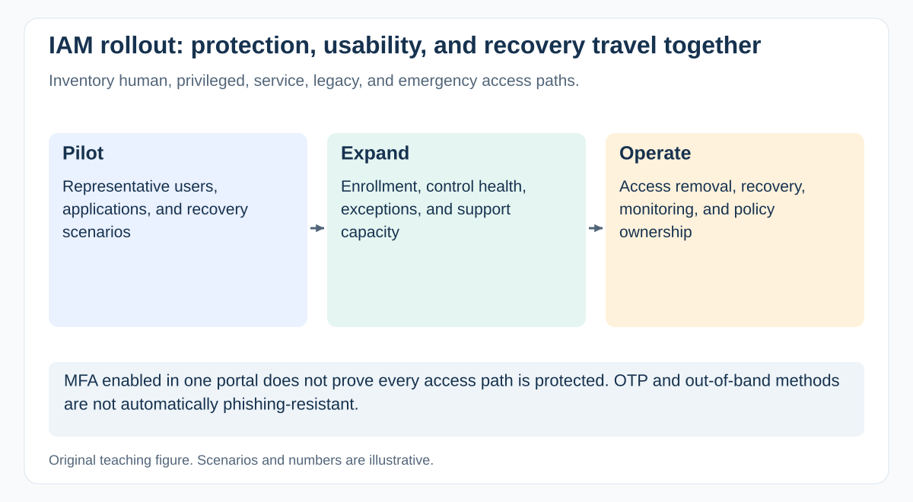

# How would you plan an IAM or MFA rollout without locking out critical users?

[Back to questions](../../README.md#cybersecurity-domain)

**Level:** Middle · **Topic:** Cybersecurity Domain · **Reviewed:** 2026-10-30

## Answer

Treat IAM or MFA as **a change to how people and systems obtain and recover access**. Configuration coverage alone does not establish effective protection or usable recovery.

## Discover every access path

Inventory users, privileged roles, contractors, service accounts, integrations, legacy protocols, emergency access, and identity providers. Separate human authentication from workload identities. Agree the intended policy, exceptions, recovery, joiner/mover/leaver handling, and access-review ownership.

NIST SP 800-63B-4 distinguishes authentication assurance and phishing resistance. OTP or out-of-band methods should not be described as phishing-resistant simply because they use a second factor. Select the required assurance and mechanism with security; NIST's normative requirements have their own scope and are not automatically universal private-sector law.

## Roll out with operational evidence

| Stage | Evidence before expansion |
| --- | --- |
| Representative pilot | Important applications and user groups can authenticate and recover |
| Controlled cohort | Enrollment, support load, exceptions, and access failures are understood |
| Broader rollout | Guardrails hold; critical and privileged paths are addressed |
| Operations | Access removal, recovery, policy maintenance, and monitoring have owners |

Plan communications, accessible enrollment, support staffing, and controlled emergency access. Break-glass arrangements need authorization, protection, monitoring, and periodic verification; an unmonitored bypass weakens the result.

## Example: the hidden legacy path

An organization enables MFA for its main web portal but leaves a legacy protocol or administrative integration outside the policy. An installation dashboard can look complete while a material access path remains exposed.

Test allowed and denied access, lost authenticator recovery, account termination, role changes, critical integrations, and unavailable identity services. Establish stop conditions for unacceptable lockouts or control gaps.

Measure effective coverage using a known population, exception age, control health, and recovery outcomes. The PM coordinates cohorts and dependencies; IAM/security owners define policy and verify its effectiveness. Zero trust is an architectural approach, not a product label or a reason to assume all access is safe.

## References

- [NIST SP 800-63B-4: authentication assurance, recovery, and phishing resistance](https://pages.nist.gov/800-63-4/sp800-63b.html)
- [NIST SP 800-207: Zero Trust Architecture](https://csrc.nist.gov/pubs/sp/800/207/final)
- [OWASP ASVS: application authentication and access requirements](https://asvs.owasp.org/)
