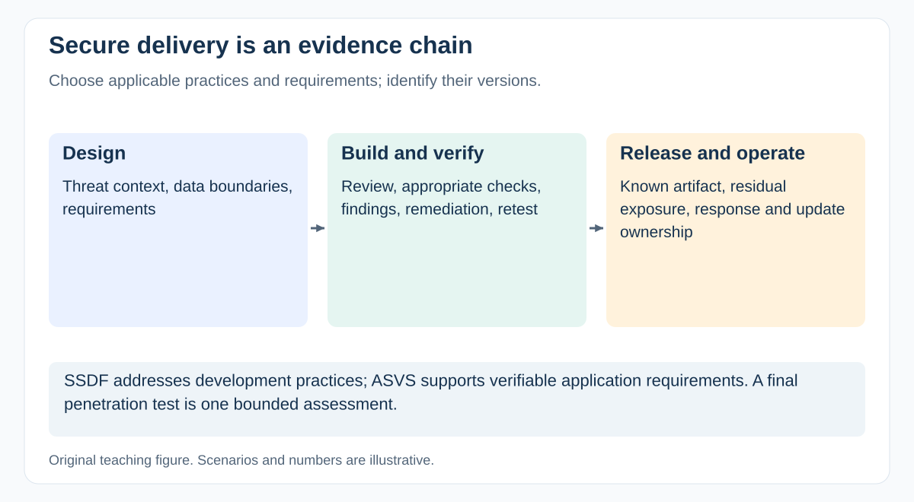

# How do you include security in delivery without relying on a final penetration test?

[Back to questions](../../README.md#cybersecurity-domain)

**Level:** Middle · **Topic:** Cybersecurity Domain · **Reviewed:** 2026-10-30

## Answer

Build security into **requirements, design, implementation, verification, release, and operation**, with evidence and ownership at each stage. A final penetration test is one bounded assessment, not a replacement for this work.

## Choose and version the framework

As checked, NIST lists **SSDF 1.1 / SP 800-218** as final and **SSDF 1.2 / SP 800-218 Rev. 1** as draft. Distinguish a draft being evaluated from an adopted requirement. OWASP **ASVS 5.0.0** is the checked stable application-security baseline; reference versioned requirements rather than relying on unstable numbering from another release.

These resources have different roles: SSDF describes secure-development practices; ASVS provides verifiable application-security requirements. Select applicable practices and depth based on the product, threat model, and obligations.

## Plan the evidence chain

| Stage | Example activity and evidence |
| --- | --- |
| Discover/design | Sensitive-data and trust-boundary assessment; security requirements |
| Build | Appropriate review, dependency and secret checks, protected build inputs |
| Verify | Requirement-linked tests, specialist assessment, findings and retests |
| Release | Artifact/configuration identity and a decision on remaining exposure |
| Operate | Vulnerability intake, update process, monitoring, response, ownership |

Tool results need triage. A clean scan does not prove the design is safe; a large finding count does not identify the most consequential exposure by itself. An SBOM can support component visibility but does not establish that every component is safe.

## Example: an export feature

Agree who may export which records, how authorization is enforced, how misuse is detected, and what evidence proves denied access. Include service accounts, administrators, secondary storage, and support access.

Schedule remediation and retest capacity before promising release. Record unresolved findings with scope, risk owner, treatment, and review trigger where acceptance is permissible. No risk-acceptance signature waives a binding legal requirement.

The PM coordinates this work and its dependencies; security and engineering assess implementation and technical evidence.

## References

- [NIST: SSDF publications, final versus draft status](https://csrc.nist.gov/Projects/ssdf/publications)
- [NIST SP 800-218: SSDF 1.1 final](https://csrc.nist.gov/pubs/sp/800/218/final)
- [OWASP ASVS: stable 5.0.0 requirements and downloads](https://asvs.owasp.org/)
