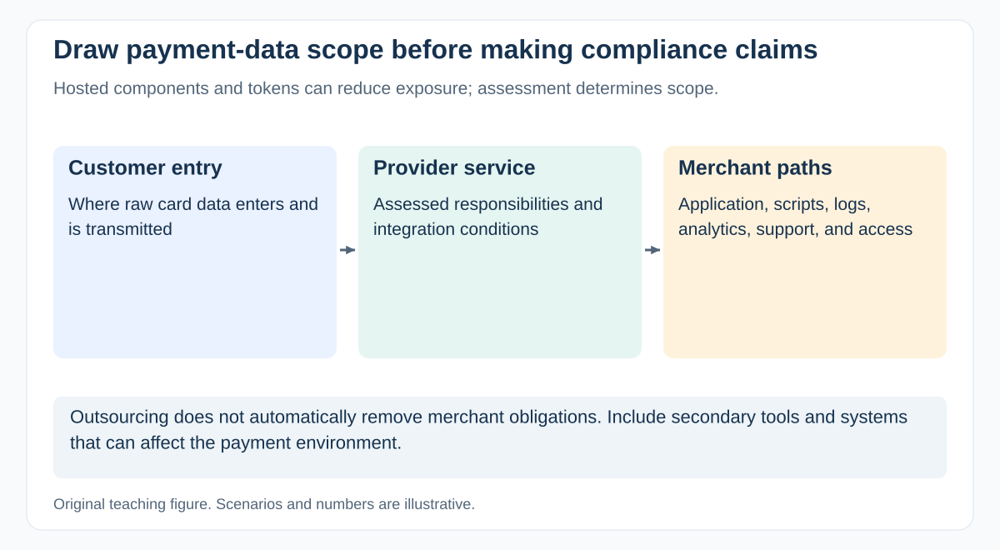

# How should PCI DSS scope influence a payment project?

[Back to questions](../../README.md#fintech-domain)

**Level:** Middle · **Topic:** Fintech Domain · **Reviewed:** 2026-10-30

## Answer

PCI DSS scope depends on **the actual card-data environment and systems that can affect its security**. The relevant owner and assessor must establish scope and the validation route; a PM should not infer them from a provider's marketing claim.

## Draw the complete boundary

Trace entry, transmission, processing, storage, administration, and onward copies. Include scripts in payment pages, logs, analytics, screenshots, customer support, backups, and systems connected to or affecting the cardholder data environment.

Hosted components, tokenization, and segmentation may reduce exposure, but outsourcing is not automatic exemption. Check implementation details, responsibilities, evidence, and applicable eligibility conditions for the selected validation approach.

## Turn scope into a delivery plan

| Workstream | Questions to resolve |
| --- | --- |
| Data flow | Can raw card data reach the application or secondary tools? |
| Suppliers | What is covered by provider evidence, and what remains with the merchant? |
| Controls | Which requirements apply to this integration and environment? |
| Verification | Who supplies assessment evidence, fixes, and retests? |
| Operations | How are changes, access, incidents, and recurring checks managed? |

In a merchant acceptance flow, sensitive authentication data such as card verification codes must not be retained after authorization, even encrypted, under the relevant PCI DSS prohibition. Confirm the actual standard and data categories with the PCI owner rather than treating all payment information alike.

## Current baseline and example

PCI DSS **v4.0.1** is the checked baseline. The limited revision did not move the **March 31, 2025** date for the future-dated v4 requirements; do not describe those as still optional after that date where they apply.

For a hosted checkout, verify that a troubleshooting integration does not copy card inputs into logs and that payment-page responsibilities are understood. A provider's compliance evidence covers its assessed service, not every consumer of it.

Record the environment, scope rationale, version, responsibilities, findings, and authorized acceptance. A successful payment test is functional evidence; it is not a PCI validation.

## References

- [PCI SSC FAQ 1319: card verification codes and post-authorization storage](https://www.pcisecuritystandards.org/faqs/1319/)
- [PCI SSC: PCI DSS scope and resources](https://www.pcisecuritystandards.org/standards/pci-dss/)
- [PCI SSC: v4.0.1 and the unchanged March 31, 2025 effective date](https://blog.pcisecuritystandards.org/just-published-pci-dss-v4-0-1)
