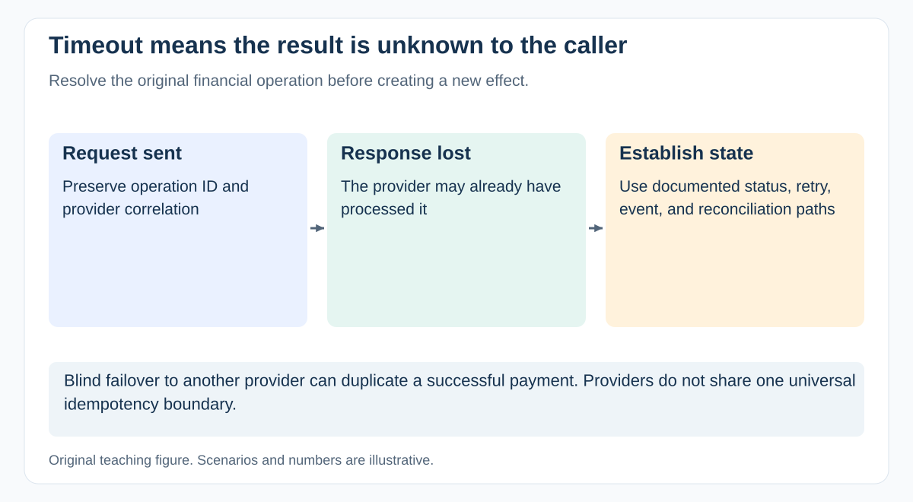

# A payment provider times out after a customer confirms payment. How do you coordinate the response?

[Back to questions](../../README.md#fintech-domain)

**Level:** Senior · **Topic:** Fintech Domain · **Reviewed:** 2026-10-30

## Answer

A timeout after payment confirmation means **the caller does not know the result**. It does not establish that no money moved. Coordinate recovery around that uncertainty.

## Establish the state before creating new effects

Activate the incident process and involve engineering, payment operations, finance, support, and the provider. Preserve business-operation identifiers, provider correlation, timestamps, and relevant evidence without exposing sensitive data.

Ask whether the original request was accepted, which authoritative status can be queried, and what webhook or reconciliation evidence may arrive later. Follow the actual provider's idempotency and error-handling contract.

| Evidence | Possible response to assess with the owners |
| --- | --- |
| Confirmed success | Update internal state consistently and verify accounting |
| Confirmed failure | Consider an authorized retry or alternative |
| Still uncertain | Keep a pending/investigation state and resolve before risking duplication |

These are decision categories, not a universal retry algorithm.

## Example: an unsafe failover

Provider A times out after a 100-unit request. Immediately sending another 100-unit payment to provider B can create two successful payments because the providers do not share an idempotency boundary. Failover needs an explicit financial design and evidence about the original operation.

Likewise, a recovered API does not resolve all transactions that were uncertain during the outage. Build an exception set and reconcile it.

## Coordinate user impact and closure

Agree customer-visible pending states, support scripts, duplicate-payment treatment, investigation ownership, and update cadence. Use targeted containment where needed instead of repeatedly retrying every record.

Track uncertain transaction count, value, and age, plus confirmed affected users. Close the service incident and financial exceptions according to their separate evidence and ownership; some resolution work can continue after traffic recovers.

Review the failure afterward: detection, state handling, retry decisions, provider dependencies, and reconciliation. The PM supports decisions and communications; technical and finance owners verify the financial result.

## References

- [Stripe: advanced error handling and indeterminate results](https://docs.stripe.com/error-low-level)
- [Stripe: idempotent request boundary](https://docs.stripe.com/api/idempotent_requests)
- [Stripe: asynchronous events and delivery behavior](https://docs.stripe.com/webhooks)
- [Google SRE Workbook: incident coordination](https://sre.google/workbook/incident-response/)
