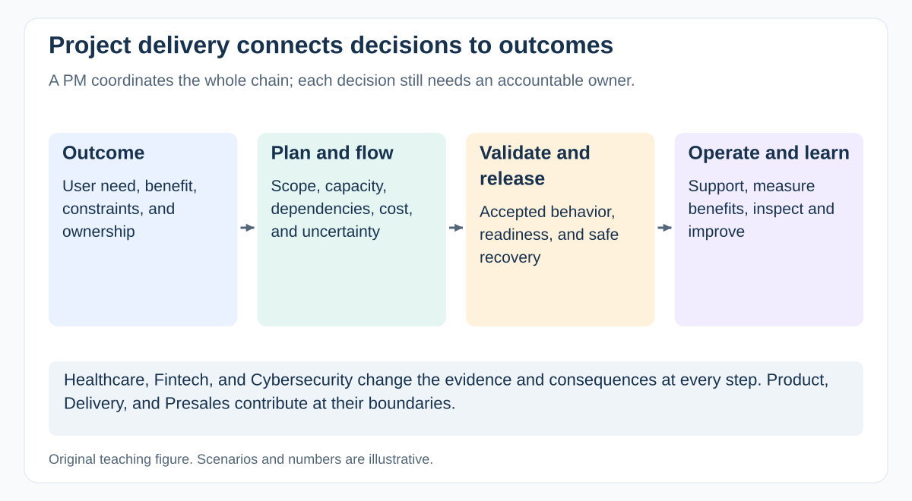

# What does a Project Manager own, and how do you define project success?

[Back to questions](../../README.md#project-management-foundations)

**Level:** Junior · **Topic:** Project Management Foundations · **Reviewed:** 2026-10-30

## Answer

A Project Manager coordinates the work needed to achieve an agreed objective within constraints. Establish the outcome, scope boundaries, decision rights, delivery approach, resources, and reporting expectations with the sponsor. Technical design and product prioritization still need explicit owners.

Distinguish delivery acceptance from benefits. A portal can launch on time while failing to reduce administrative work. Record both an acceptance measure, such as successful completion of agreed workflows, and an outcome measure, such as processing time after adoption. Assign a benefits owner and a review date beyond launch. Do not claim success using schedule alone.

## Make success testable

For a hypothetical claims portal, agree three layers:

| Layer | Example measure | Accountable owner |
| --- | --- | --- |
| Delivery | Agreed workflows accepted within the approved funding | Sponsor and delegated acceptance owner |
| Operational readiness | Support can detect failures and recover the service | Service owner |
| Benefit | Median handling time falls from 12 to 8 minutes after adoption | Business benefits owner |

Define the population, baseline period, target date, and guardrails such as error rate. These are illustrative targets, not industry benchmarks.

The PM maintains the integrated view and escalates trade-offs. The sponsor owns continuing investment justification; an operational or business owner must sustain benefits after the temporary project team leaves. If handling time stays unchanged, investigate adoption and workflow assumptions rather than declaring success from the release date alone.

## References

- [GovS 002 v2.1: sections 4.4 and 7.3, accountability and benefits](https://projectdelivery.gov.uk/library-products/government-functional-standard-govs-002-project-delivery/)
- [PMI: what is project management](https://www.pmi.org/about/what-is-project-management)
