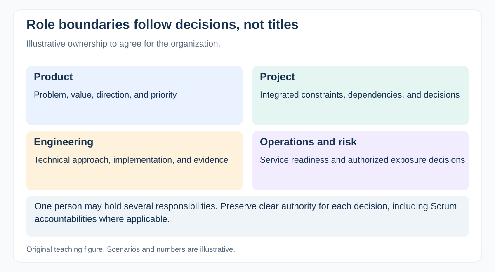

# How do Project Manager, Product Manager, Delivery Manager, Scrum Master, and Business Analyst differ?

[Back to questions](../../README.md#project-management-foundations)

**Level:** Junior · **Topic:** Project Management Foundations · **Reviewed:** 2026-10-30

## Answer

Titles vary, so agree accountabilities rather than infer them. A Project Manager typically coordinates a bounded initiative and its constraints. A Product Manager focuses on customer problems, product direction, and outcomes. A Delivery Manager improves how work reaches users across teams. A Business Analyst develops shared understanding of needs and requirements.

Scrum defines Scrum Master, Product Owner, and Developers accountabilities; it does not define a Project Manager accountability. Someone can perform project coordination without taking backlog ordering from the Product Owner or implementation planning from Developers. Write down who decides scope, funding, technical design, acceptance, and release.

## Resolve a real overlap

Suppose a customer requests a new fraud rule before launch:

| Decision | Typical lead, subject to local delegation |
| --- | --- |
| Whether the outcome merits priority | Product decision maker |
| How to implement and verify it | Engineering and relevant specialists |
| Effect on date, cost, dependencies, and agreement | Project Manager coordinates |
| Whether remaining exposure is permissible | Authorized business and risk owners |
| How team flow or Scrum effectiveness improves | Delivery Manager or Scrum Master within their remit |

One person may hold several responsibilities, but each decision still needs clear authority. Ask who can say no, who supplies evidence, and who resolves disagreement. This is more useful than memorizing job-title definitions.

## References

- [PMI: what is project management](https://www.pmi.org/about/what-is-project-management)
- [The Scrum Guide (2020)](https://scrumguides.org/scrum-guide.html)
