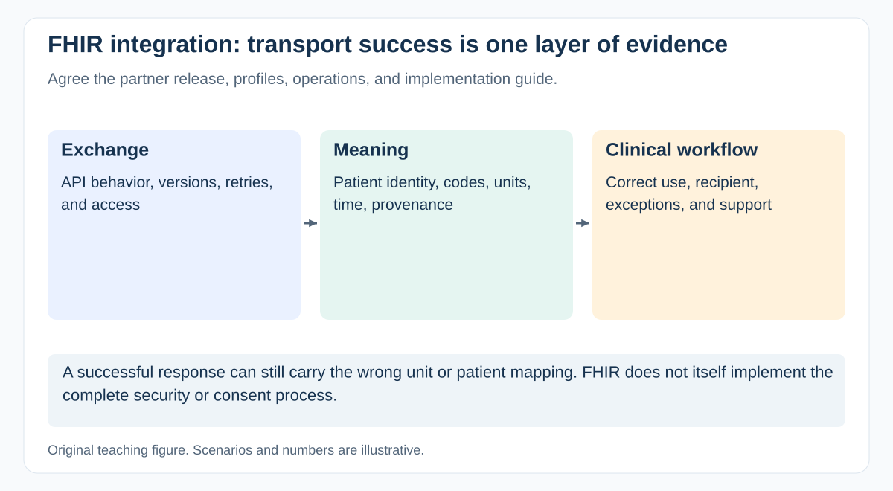

# What makes EHR or FHIR integration more than a standard API task?

[Back to questions](../../README.md#healthcare-domain)

**Level:** Middle · **Topic:** Healthcare Domain · **Reviewed:** 2026-10-30

## Answer

An EHR integration succeeds when the receiving workflow obtains the **right information, for the right patient, with the right meaning and permissions**. A successful API response proves only part of that.

## Agree the interoperability contract

Confirm the partner's FHIR release, profiles and extensions, implementation guide, terminology bindings, identifiers, supported operations, and capability statement. R4 and R5 are not interchangeable labels. As checked, HL7 lists R5 5.0.0 as the current published release and R6 material in its work-in-progress sequence; use the partner's supported contract rather than a development build.

FHIR also coexists with HL7 v2, documents, and other exchange approaches. A partner saying “we support FHIR” does not establish that the required operation or profile is implemented.

## Test meaning as well as transport

| Concern | Example to verify |
| --- | --- |
| Identity | Duplicate identifiers, merged records, and corrections |
| Clinical meaning | Units, codes, status, reference ranges, and absent values |
| Time and provenance | Event time versus receipt time; source and author |
| Workflow | Late results, amended results, unavailable recipients |
| Security | Authentication, scoped access, consent-related rules, audit evidence |

For an illustrative laboratory result, receiving a number is insufficient if its unit or patient identifier is mapped incorrectly. Ask domain specialists to define representative normal, abnormal, corrected, and incomplete cases.

## Delivery and ownership

Plan access, safe test data, terminology mapping, conformance checks, end-to-end validation, production credentials, partner support, and operational reconciliation. Establish how breaking changes and failed messages are detected and resolved.

FHIR is not itself a security protocol. Use an appropriate security architecture; SMART App Launch may be relevant where the partner supports that profile. Do not assume the mere presence of a Consent or AuditEvent resource implements a complete authorization or compliance process.

The PM makes prerequisites, evidence, and owners visible. Clinical and technical specialists assess semantics and implementation correctness.

## References

- [HL7: FHIR publication directory and development status](https://hl7.org/fhir/directory.html)
- [HL7: FHIR R4 overview, a versioned integration example](https://hl7.org/fhir/R4/overview.html)
- [HL7: FHIR security considerations](https://hl7.org/fhir/security.html)
