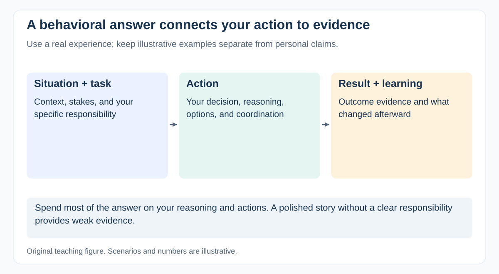

# How should you answer a behavioral question about a project failure?

[Back to questions](../../README.md#leadership-and-behavioral-questions)

**Level:** Middle · **Topic:** Leadership and Behavioral Questions · **Reviewed:** 2026-10-30

## Answer

Use a concise STAR structure: Situation, Task, Action, Result. Explain your actual responsibility, the evidence available at the time, the decision you made, and the consequences. State what changed afterward and how you checked that it helped.

Prepare a real example involving a missed dependency, poor scope decision, or communication failure. Distinguish your actions from the team's collective work and acknowledge what you would do differently. Do not invent metrics or disclose confidential client details. A useful answer demonstrates judgment and learning; an example where everyone else was wrong gives little evidence of your own growth.

## Build a credible two-minute story

Use this structure with a real experience:

| Part | What to explain |
| --- | --- |
| Situation | Context and the consequence at stake |
| Task | Your specific responsibility and constraints |
| Action | What you decided, why, and who you involved |
| Result | What happened and what evidence supports it |
| Learning | What you changed and whether it helped later |

An illustrative failure might involve validating a supplier assumption too late. Explain the missed signal, your recovery decision, the effect on the client, and the new validation trigger. Do not present that illustration as your own experience.

Give most of the time to your reasoning and actions. A polished story with no verifiable responsibility provides little evidence of judgment.

## References

- [National Careers Service: the STAR method](https://nationalcareers.service.gov.uk/careers-advice/interview-advice/the-star-method)
- [Google SRE Workbook: Postmortem Culture](https://sre.google/workbook/postmortem-culture/)
