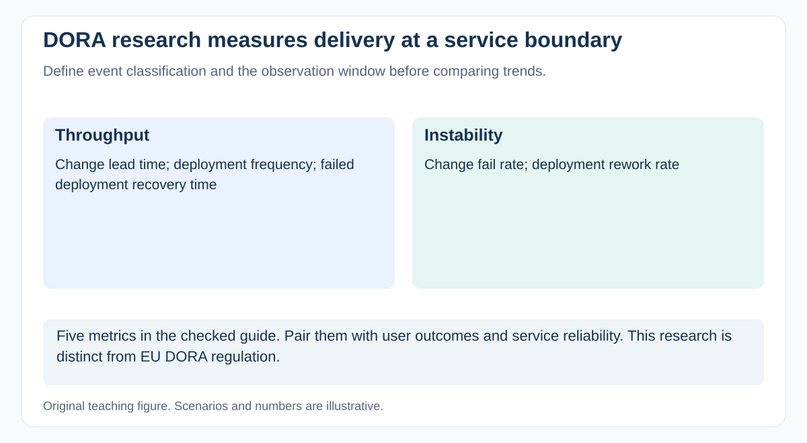

# What do DORA software delivery metrics measure, and how should a PM use them?

[Back to questions](../../README.md#metrics-and-continuous-improvement)

**Level:** Middle · **Topic:** Metrics and Continuous Improvement · **Reviewed:** 2026-10-30

## Answer

DORA's current guide describes five metrics: change lead time, deployment frequency, failed deployment recovery time, change fail rate, and deployment rework rate. The recovery measure concerns failed deployments; it is not a generic recovery clock for every incident.

Use the measures at an application or service boundary with engineering and operations. Inspect trends and bottlenecks alongside reliability and user outcomes. Avoid ranking individuals or comparing unlike services. A deployment is not necessarily a customer-visible release. Specify the definitions and observation window, and revisit the guide when using historical four-metric terminology. This DORA research is distinct from the EU DORA regulation.

## Define the clocks and denominators

| Metric | Measurement boundary |
| --- | --- |
| Change lead time | Commit to production deployment |
| Deployment frequency | Production deployments per stated period |
| Failed deployment recovery time | Recovery from a deployment requiring immediate intervention |
| Change fail rate | Share of deployments requiring immediate intervention |
| Deployment rework rate | Share of deployments that are unplanned because of production incidents |

Agree how events are classified, linked, and observed. For example, a hotfix can affect both failure and rework measures; the metrics answer different questions and are not interchangeable.

Investigate the mechanism of change: smaller batches, shorter review waiting, or safer deployment. These measures describe delivery performance for a service; pair them with product value and operational objectives.

## References

- [DORA: software delivery performance metrics](https://dora.dev/guides/dora-metrics/)
