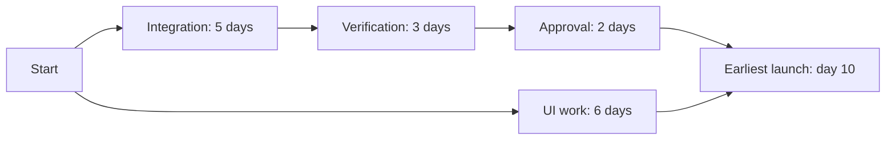

# What is the critical path, and how does it affect a delivery forecast?

[Back to questions](../../README.md#planning-and-estimation)

**Level:** Middle · **Topic:** Planning and Estimation

## Answer

The critical path is the longest-duration path through the activity network under the current assumptions. Its activities determine the earliest modeled finish. Float indicates how much an activity can move without delaying the relevant milestone; resource constraints may require revising the network.

If integration takes five days, verification three, and approval two in sequence, that path takes ten days even when separate UI work takes six. Accelerating UI work does not shorten it. Inspect assumptions, approval queues, and resource availability before choosing acceleration. More than one path can become critical after a change.

## References

- [UK Government: Project Delivery Functional Standard](https://www.gov.uk/government/publications/project-delivery-functional-standard)
