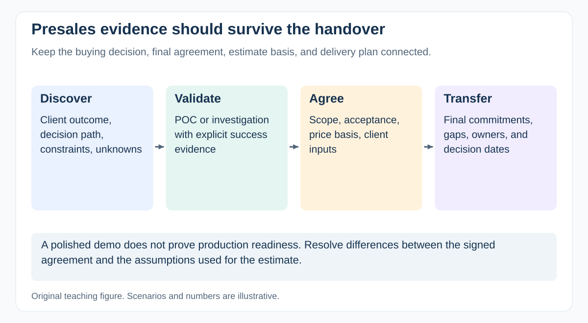

# How do you prevent presales promises from becoming delivery surprises?

[Back to questions](../../README.md#presales-and-solutions---adjacent)

**Level:** Senior · **Topic:** Presales and Solutions - Adjacent · **Reviewed:** 2026-10-30

## Answer

Arrange a handover involving sales, solution owners, delivery, and relevant specialists. Review signed scope, assumptions, estimates, constraints, acceptance, client dependencies, commercial terms, and decisions made during negotiation.

Compare the final agreement with the proposal and technical assessment. Resolve gaps before turning a target into a team commitment; if an obligation already exists, escalate options and consequences promptly. Give every unresolved item an owner. Preserve the estimate basis and client context so delivery can explain the plan without repeating discovery or silently absorbing unpriced work.

## Resolve one typical mismatch

The proposal assumed one identity provider, but the signed scope includes three. Compare integration differences, test access, certification, and ongoing support before scheduling the same original estimate.

If the contract is already signed, establish the obligation with the commercial owner and present feasible options; do not silently erase it from the delivery plan. Record agreed changes and remaining exposure through the authorized process.

The handover is complete when the receiving team can explain the client outcome, commitments, estimate basis, and unresolved decisions. A folder of sales slides without that shared understanding is incomplete.

## References

- [GovS 002 v2.1: section 7.11: procurement and contract management](https://projectdelivery.gov.uk/library-products/government-functional-standard-govs-002-project-delivery/)
