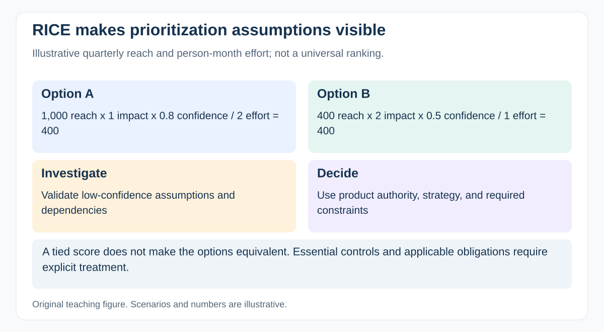

# How can RICE help prioritization, and what are its limits?

[Back to questions](../../README.md#product-management---adjacent)

**Level:** Middle · **Topic:** Product Management - Adjacent · **Reviewed:** 2026-10-30

## Answer

RICE combines reach, impact, confidence, and effort: (reach × impact × confidence) / effort. Use comparable periods, scales, and effort units. Its main value is making assumptions discussable, not producing an unquestionable ranking.

A low-confidence estimate should prompt research. Dependencies, essential controls, and contractual constraints still need explicit judgment. Work with the product decision maker to compare options; the PM contributes delivery cost, timing, and risk. A high score does not authorize unsafe scope or replace an accountable priority decision.

## Calculate a small example

Option A reaches 1,000 users per quarter, has impact 1, confidence 0.8, and effort 2 person-months: its illustrative score is 400. Option B reaches 400, has impact 2, confidence 0.5, and effort 1: its score is also 400.

The tie exposes the assumptions; it does not make the options equivalent in every respect. Validate the low-confidence input, consider dependencies and strategic fit, and distinguish required controls from discretionary opportunities.

Use the same reach period and effort convention for both. The product decision maker owns the final priority, informed by delivery evidence and relevant obligations.

## References

- [Intercom: RICE prioritization](https://www.intercom.com/blog/rice-simple-prioritization-for-product-managers)
