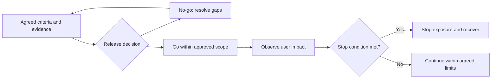

# What evidence do you need for a go/no-go release decision?

[Back to questions](../../README.md#quality-release-and-operations)

**Level:** Middle · **Topic:** Quality, Release, and Operations

## Answer

Agree criteria before launch: required behavior and quality evidence, critical defect disposition, security and privacy checks, migration results, operational ownership, user communications, and recovery readiness. Confirm that the release artifact and configuration match the evidence.

Make remaining uncertainty visible to the authorized decision maker. If a rollback plan exists only on paper, ask what has actually been tested and what data it can recover. Define who can stop exposure and what conditions trigger that action. Readiness is specific to the release boundary; a pilot approval should not silently become approval for every user and integration.

## References

- [UK Government: Project Delivery Functional Standard](https://www.gov.uk/government/publications/project-delivery-functional-standard)
- [Google SRE Workbook: Canarying Releases](https://sre.google/workbook/canarying-releases/)
