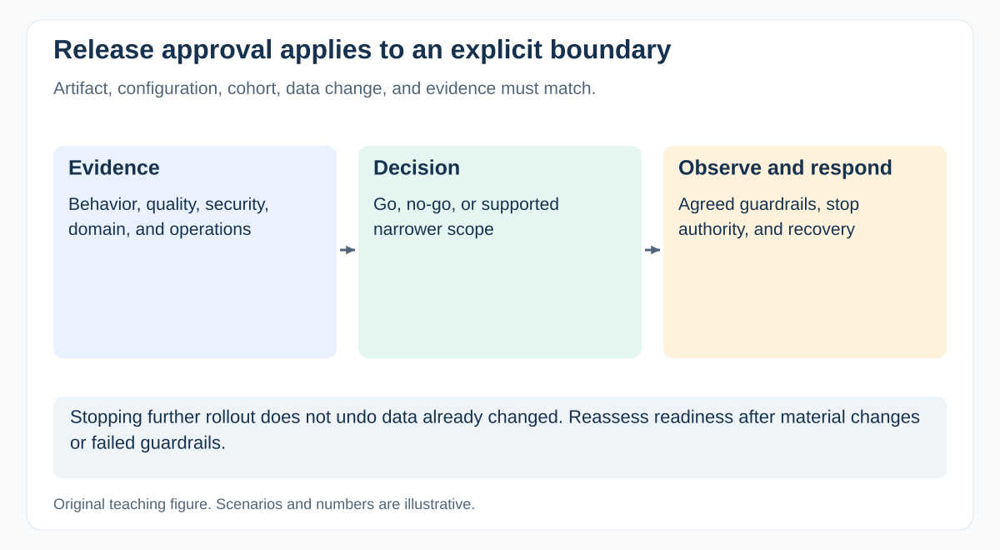

# What evidence do you need for a go/no-go release decision?

[Back to questions](../../README.md#quality-release-and-operations)

**Level:** Middle · **Topic:** Quality, Release, and Operations · **Reviewed:** 2026-10-30

## Answer

Agree criteria before launch: required behavior and quality evidence, critical defect disposition, security and privacy checks, migration results, operational ownership, user communications, and recovery readiness. Confirm that the release artifact and configuration match the evidence.

Make remaining uncertainty visible to the authorized decision maker. If a rollback plan exists only on paper, ask what has actually been tested and what data it can recover. Define who can stop exposure and what conditions trigger that action. Readiness is specific to the release boundary; a pilot approval should not silently become approval for every user and integration.

## Decide within an explicit boundary

A release record should name the artifact, configuration, cohort, data transition, unresolved findings, evidence versions, and accountable decision makers. Ask which assumptions would make the approval invalid.

For a pilot, limit eligible users or sites and state what expansion requires. Confirm support staffing, stop authority, and the action after a threshold is crossed. Define thresholds before seeing favorable or unfavorable results to reduce ad hoc reinterpretation.

Use a go/no-go meeting to resolve a decision, not to discover every prerequisite for the first time. If critical evidence is missing, record a no-go or a demonstrably permissible narrower scope. A deadline does not supply missing assurance.

## References

- [GovS 002 v2.1: sections 8.2, 8.6–8.9: quality, validation and transition](https://projectdelivery.gov.uk/library-products/government-functional-standard-govs-002-project-delivery/)
- [Google SRE Workbook: Canarying Releases](https://sre.google/workbook/canarying-releases/)
