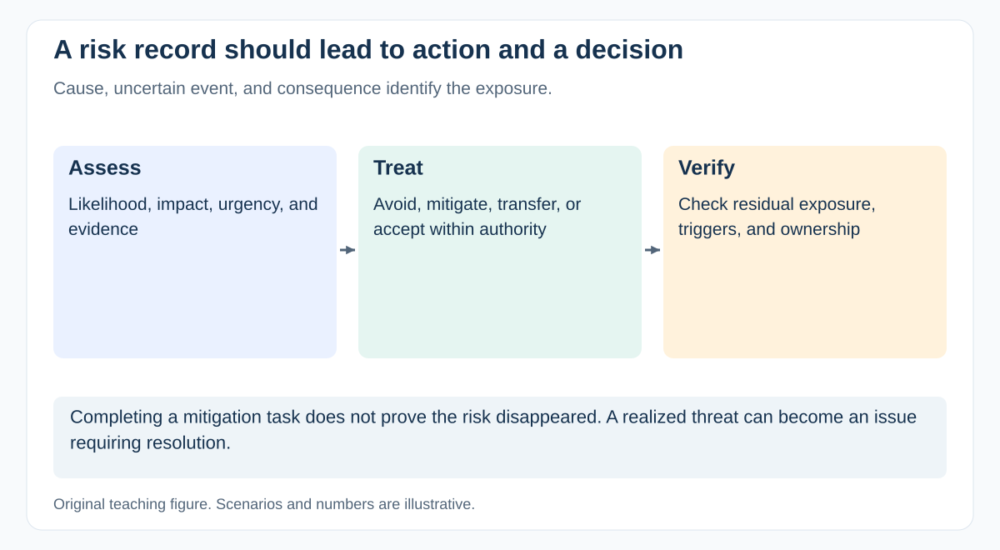

# What makes a risk register actionable?

[Back to questions](../../README.md#risk-and-issue-management)

**Level:** Junior · **Topic:** Risk and Issue Management · **Reviewed:** 2026-10-30

## Answer

Describe the cause, possible event, and impact on an objective. Add likelihood, impact, owner, response, trigger, due date, and residual exposure. Use consistent scales and keep important risks visible in decisions.

“Integration risk” is too vague. “If the provider misses certification, launch may move by two weeks” supports a response: reserve a slot, validate entry conditions early, and prepare a reduced-scope alternative. Review whether actions changed exposure. A register with many low-value entries and no assigned response can create reporting work while leaving the real uncertainty unmanaged.

## Make one entry decision-ready

An illustrative entry could be: “Because certification slots are limited, a missed entry test may push the provider review out by two weeks, threatening launch.” Assign a response owner to confirm the slot and complete a rehearsal before the booking deadline.

Record the initial assessment and residual exposure after that action. Add the trigger that activates a fallback and the person who may authorize it. A response action completing is not proof that the risk has disappeared.

Prioritize review effort on exposure that can still be changed. Archive resolved risks with rationale and retain linked decisions; repeatedly reviewing expired risks can obscure emerging ones.

## References

- [GovS 002 v2.1: section 7.6: risk and issue management](https://projectdelivery.gov.uk/library-products/government-functional-standard-govs-002-project-delivery/)
