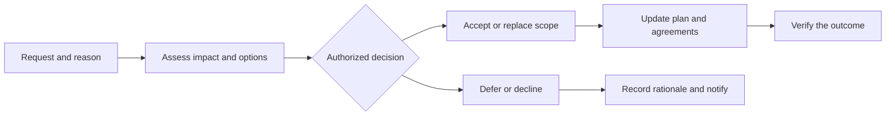

# How do you handle scope changes without blocking useful learning?

[Back to questions](../../README.md#scope-and-requirements)

**Level:** Middle · **Topic:** Scope and Requirements

## Answer

Make the request, reason, impact, options, and decision owner visible. Assess effects on outcomes, schedule, cost, quality, contracts, and dependencies. Route the decision according to agreed authority; not every backlog refinement needs a steering committee.

If a hospital adds a new site, investigate identity, training, workflow differences, and rollout support before accepting it as a small configuration change. The sponsor may fund it, replace other scope, defer it, or decline it. Record the decision and update the plan and affected agreements. An adaptive backlog allows learning, but it does not make contractual or budget changes free.

## References

- [UK Government: Project Delivery Functional Standard](https://www.gov.uk/government/publications/project-delivery-functional-standard)
