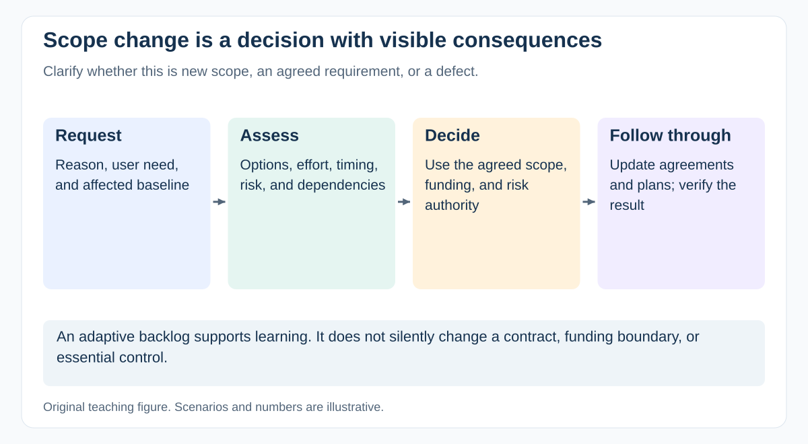

# How do you handle scope changes without blocking useful learning?

[Back to questions](../../README.md#scope-and-requirements)

**Level:** Middle · **Topic:** Scope and Requirements · **Reviewed:** 2026-10-30

## Answer

Make the request, reason, impact, options, and decision owner visible. Assess effects on outcomes, schedule, cost, quality, contracts, and dependencies. Route the decision according to agreed authority; not every backlog refinement needs a steering committee.

If a hospital adds a new site, investigate identity, training, workflow differences, and rollout support before accepting it as a small configuration change. The sponsor may fund it, replace other scope, defer it, or decline it. Record the decision and update the plan and affected agreements. An adaptive backlog allows learning, but it does not make contractual or budget changes free.

## Distinguish change from clarification

If an agreed rule was “one hospital site” and the client adds a second, assess a scope change. If the team failed to implement an already agreed role restriction, that is a defect rather than automatically chargeable new scope. Ambiguity needs joint interpretation using the actual agreement.

A useful change record compares the current baseline with alternatives: add budget and time, exchange other scope, deliver later, or decline. Include support and data consequences, not only development effort.

After a decision, update the backlog, forecast, acceptance evidence, and affected agreement through the authorized process. Communicate which previous expectation changes. Approval in one meeting is insufficient if the team continues using the old plan.

## References

- [GovS 002 v2.1: sections 7.7–7.8 and 8.3: change, traceability and requirements](https://projectdelivery.gov.uk/library-products/government-functional-standard-govs-002-project-delivery/)
