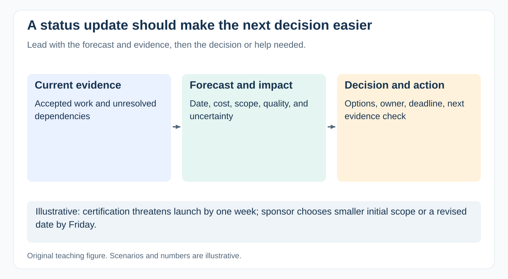

# What should a useful project status update contain?

[Back to questions](../../README.md#stakeholders-and-communication)

**Level:** Junior · **Topic:** Stakeholders and Communication · **Reviewed:** 2026-10-30

## Answer

Lead with the forecast and the decision or help needed. Include progress supported by accepted work, milestone changes, budget outlook, major risks and issues, and next steps with owners. Show trends against the baseline and define status thresholds.

“Amber: provider certification threatens launch by one week; sponsor decision on reduced scope needed Friday” is more useful than “80 percent complete.” Tailor detail to the audience while preserving a common factual source. Report material deterioration when it becomes known rather than waiting for the scheduled meeting. A green label cannot compensate for missing acceptance evidence.

## Show a compact report

- **Forecast:** launch is currently one week later than target, conditional on certification.
- **Evidence:** two of three integrated journeys accepted; the final provider test is not booked.
- **Cost:** forecast remains within the approved envelope, with a stated reserve assumption.
- **Decision:** sponsor chooses reduced initial scope or a changed date by Friday.
- **Next check:** provider confirms the slot tomorrow; technical owner verifies entry readiness.

These are illustrative fields, not a universal reporting policy. Show what changed since the previous report and keep the link to underlying evidence.

Use trends and explicit thresholds for RAG status. “Green” should mean the agreed tolerance is met, not that the team is busy or the report contains no complaints.

## References

- [GovS 002 v2.1: sections 7.12–7.13: stakeholder engagement and communications](https://projectdelivery.gov.uk/library-products/government-functional-standard-govs-002-project-delivery/)
