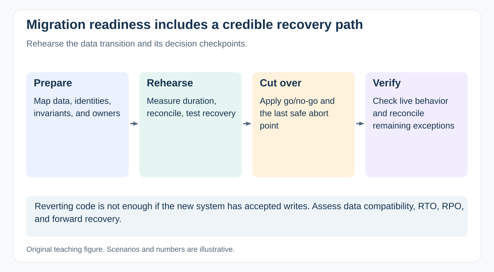

# How would you plan a data migration and decide whether cutover is safe?

[Back to questions](../../README.md#technical-literacy-for-pms)

**Level:** Senior · **Topic:** Technical Literacy for PMs · **Reviewed:** 2026-10-30

## Answer

Define data scope, mapping, ownership, quality checks, reconciliation, access controls, and the permitted service interruption. Rehearse with representative data and record runtime, exceptions, and recovery evidence. Agree a freeze or delta-sync approach when source data continues changing.

Set go/no-go conditions and a last safe decision point. Check whether rollback can preserve writes made after cutover; restoring old code may not restore consistent data. Include operational staffing, user communications, and exception handling. For a patient or financial record migration, unresolved identity or balance discrepancies require an explicit decision by the accountable business and risk owners.

## Rehearse the decision path

Create checkpoints for extract, transform, load, reconciliation, service verification, and authorized cutover. Compare record counts and domain invariants: matching totals alone does not prove that records belong to the correct customer or patient.

Measure rehearsal runtime and recovery time against the actual window. Define the acceptable data-loss window (RPO) and restoration-time target (RTO) where relevant. Confirm ownership of writes occurring during and after transition.

If the new system accepts transactions before failure is detected, reverting a database snapshot may lose valid activity. Engineering and business operations must design reconciliation or forward recovery. The PM schedules and coordinates that evidence before the last safe abort point.

## References

- [GovS 002 v2.1: sections 8.4–8.6: design, integration and verification](https://projectdelivery.gov.uk/library-products/government-functional-standard-govs-002-project-delivery/)
- [NIST SP 800-218: Secure Software Development Framework](https://csrc.nist.gov/pubs/sp/800/218/final)
