# Visual guide

[All questions](../README.md) · [Answer index](../answers/README.md) · [Source notes](source-notes.md)

Diagrams and worked charts for planning, delivery, and domain scenarios. Open the corresponding answer for the explanation and references.

Numbers in the worked examples are illustrative. The forecast chart shows a simulation under stated assumptions.

## Find an illustration

| Figure | Explanation |
| --- | --- |
| [Critical path: improve the path that drives the finish](../assets/diagrams/critical-path.svg) | [Open answer](../answers/planning-and-estimation/critical-path.md) |
| [A forecast is a distribution, conditional on assumptions](../assets/diagrams/forecast-distribution.svg) | [Open answer](../answers/planning-and-estimation/forecasting-under-uncertainty.md) |
| [Capacity: nominal availability is only the starting point](../assets/diagrams/capacity.svg) | [Open answer](../answers/planning-and-estimation/capacity-resource-planning.md) |
| [Earned value: compare planned work, accepted work, and cost](../assets/diagrams/earned-value.svg) | [Open answer](../answers/budget-and-commercials/earned-value.md) |
| [A burnup separates scope arrival from completed work](../assets/diagrams/burnup-burndown.svg) | [Open answer](../answers/metrics-and-improvement/burndown-burnup.md) |
| [Cumulative flow: a growing band makes waiting visible](../assets/diagrams/cumulative-flow.svg) | [Open answer](../answers/delivery-adjacent/multi-team-flow.md) |
| [Error budget: define the denominator before doing the math](../assets/diagrams/error-budget.svg) | [Open answer](../answers/metrics-and-improvement/sli-slo-sla.md) |
| [Project delivery connects decisions to outcomes](../assets/diagrams/delivery-system.svg) | [Open answer](../answers/foundations/project-success.md) |
| [Scope change is a decision with visible consequences](../assets/diagrams/scope-change.svg) | [Open answer](../answers/scope-and-requirements/change-control.md) |
| [Scrum: artifacts make goals, plans, and quality inspectable](../assets/diagrams/scrum-goals.svg) | [Open answer](../answers/agile-and-flow/backlogs-and-goals.md) |
| [Lead time, cycle time, and age use explicit boundaries](../assets/diagrams/flow-time.svg) | [Open answer](../answers/agile-and-flow/flow-metrics.md) |
| [A risk record should lead to action and a decision](../assets/diagrams/risk-response.svg) | [Open answer](../answers/risk-and-issues/risk-register.md) |
| [A status update should make the next decision easier](../assets/diagrams/status-decision.svg) | [Open answer](../answers/stakeholders-and-communication/status-reporting.md) |
| [A behavioral answer connects your action to evidence](../assets/diagrams/star.svg) | [Open answer](../answers/leadership-and-behavioral/failure-star.md) |
| [Migration readiness includes a credible recovery path](../assets/diagrams/migration.svg) | [Open answer](../answers/technical-literacy/data-migration.md) |
| [Release approval applies to an explicit boundary](../assets/diagrams/release-readiness.svg) | [Open answer](../answers/quality-and-release/release-readiness.md) |
| [DORA research measures delivery at a service boundary](../assets/diagrams/dora-metrics.svg) | [Open answer](../answers/metrics-and-improvement/dora-metrics.md) |
| [Patient data can leave through secondary paths](../assets/diagrams/health-data.svg) | [Open answer](../answers/healthcare/patient-data-and-privacy.md) |
| [FHIR integration: transport success is one layer of evidence](../assets/diagrams/fhir-layers.svg) | [Open answer](../answers/healthcare/ehr-fhir-integration.md) |
| [Clinical evaluation asks three different evidence questions](../assets/diagrams/clinical-evaluation.svg) | [Open answer](../answers/healthcare/clinical-validation.md) |
| [A card payment has several distinct states](../assets/diagrams/payment-lifecycle.svg) | [Open answer](../answers/fintech/payment-lifecycle.md) |
| [Timeout means the result is unknown to the caller](../assets/diagrams/payment-timeout.svg) | [Open answer](../answers/fintech/provider-outage-case.md) |
| [Reconciliation compares independent records](../assets/diagrams/reconciliation.svg) | [Open answer](../answers/fintech/financial-correctness.md) |
| [Draw payment-data scope before making compliance claims](../assets/diagrams/pci-boundary.svg) | [Open answer](../answers/fintech/pci-scope.md) |
| [Secure delivery is an evidence chain](../assets/diagrams/security-evidence.svg) | [Open answer](../answers/cybersecurity/secure-sdlc.md) |
| [Incident coordination needs parallel owners](../assets/diagrams/incident-coordination.svg) | [Open answer](../answers/cybersecurity/cyber-incident-coordination.md) |
| [IAM rollout: protection, usability, and recovery travel together](../assets/diagrams/iam-rollout.svg) | [Open answer](../answers/cybersecurity/iam-rollout.md) |
| [SOC capability is a tested detection-to-response chain](../assets/diagrams/soc-detection.svg) | [Open answer](../answers/cybersecurity/soc-siem-delivery.md) |
| [Presales evidence should survive the handover](../assets/diagrams/presales-handover.svg) | [Open answer](../answers/presales-adjacent/sales-to-delivery-handover.md) |
| [Role boundaries follow decisions, not titles](../assets/diagrams/role-boundaries.svg) | [Open answer](../answers/foundations/role-boundaries.md) |
| [Severity is one input to vulnerability prioritization](../assets/diagrams/vulnerability-priority.svg) | [Open answer](../answers/cybersecurity/vulnerability-prioritization.md) |
| [RICE makes prioritization assumptions visible](../assets/diagrams/rice-example.svg) | [Open answer](../answers/product-adjacent/rice-and-priority.md) |

## Worked charts

### Critical path: improve the path that drives the finish

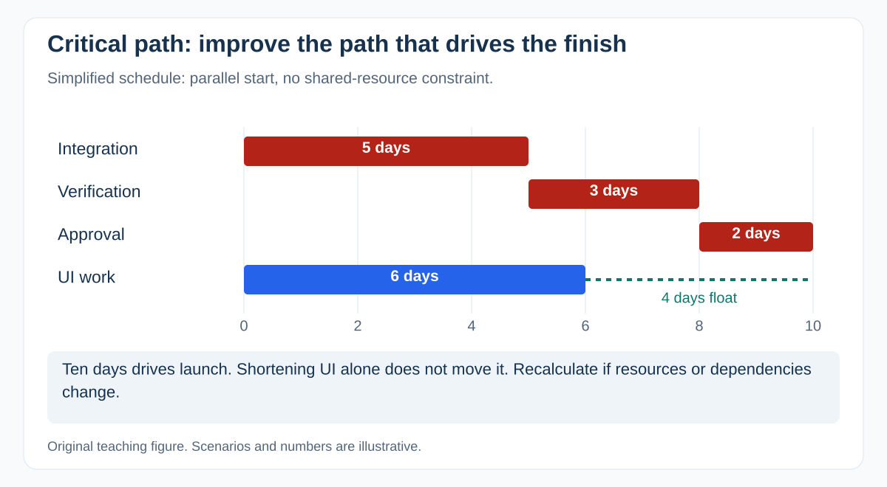

[Explanation, assumptions, and references](../answers/planning-and-estimation/critical-path.md)

### A forecast is a distribution, conditional on assumptions

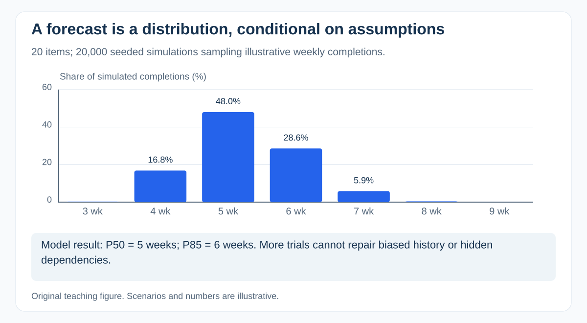

[Explanation, assumptions, and references](../answers/planning-and-estimation/forecasting-under-uncertainty.md)

### Capacity: nominal availability is only the starting point

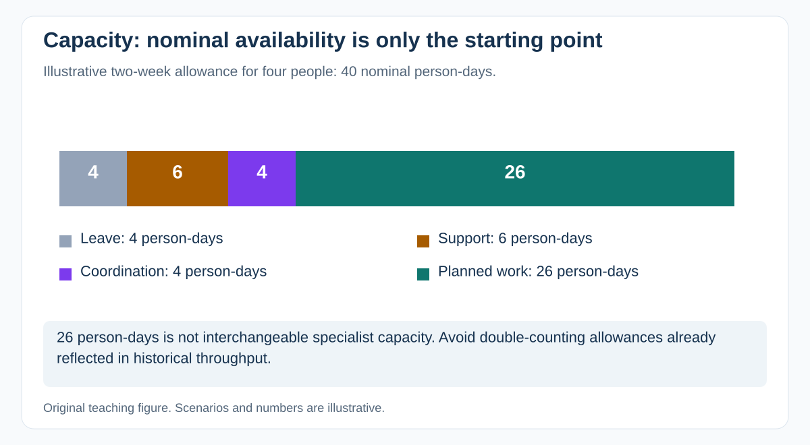

[Explanation, assumptions, and references](../answers/planning-and-estimation/capacity-resource-planning.md)

### Earned value: compare planned work, accepted work, and cost

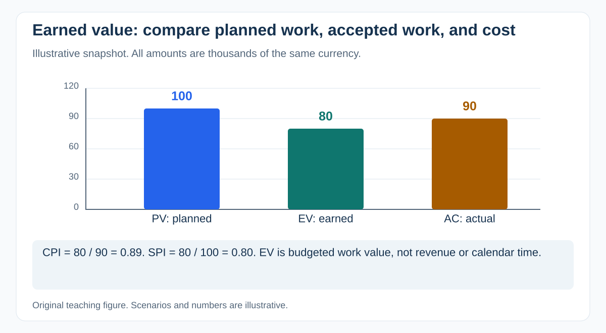

[Explanation, assumptions, and references](../answers/budget-and-commercials/earned-value.md)

### A burnup separates scope arrival from completed work

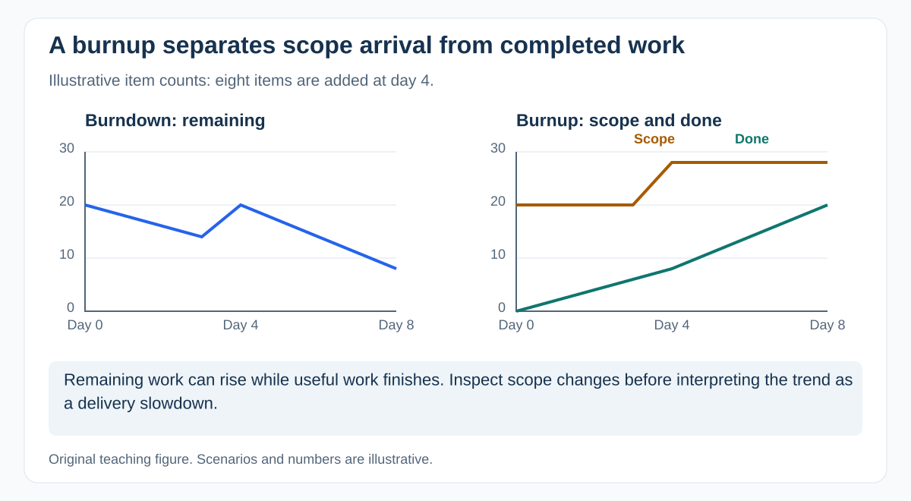

[Explanation, assumptions, and references](../answers/metrics-and-improvement/burndown-burnup.md)

### Cumulative flow: a growing band makes waiting visible

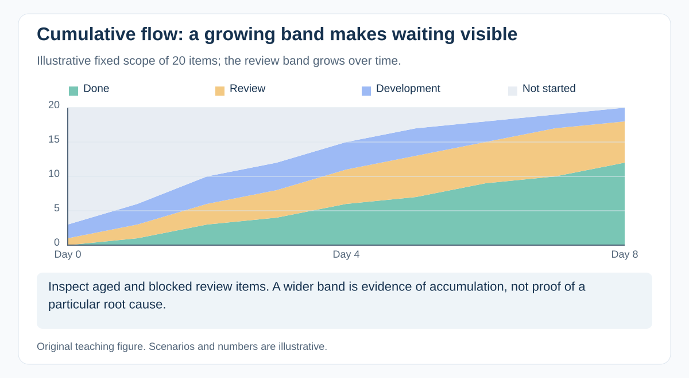

[Explanation, assumptions, and references](../answers/delivery-adjacent/multi-team-flow.md)

### Error budget: define the denominator before doing the math

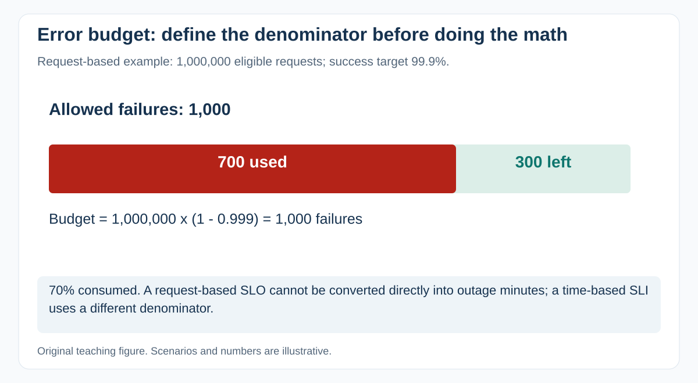

[Explanation, assumptions, and references](../answers/metrics-and-improvement/sli-slo-sla.md)

## Domain explanations

### Patient data can leave through secondary paths

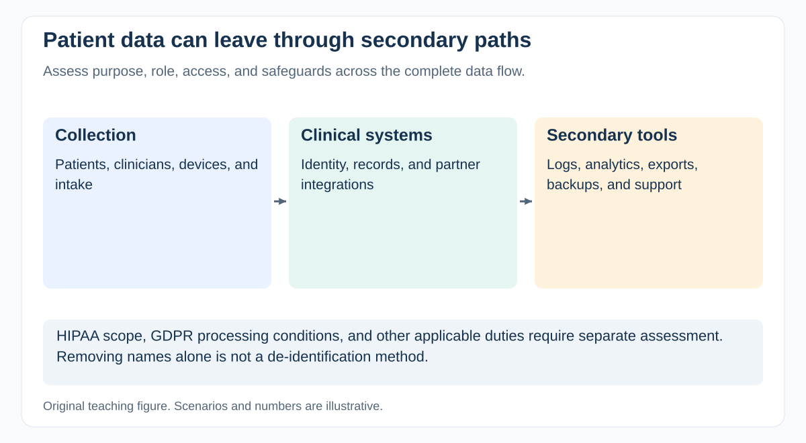

[Explanation and sources](../answers/healthcare/patient-data-and-privacy.md)

### Clinical evaluation asks three different evidence questions

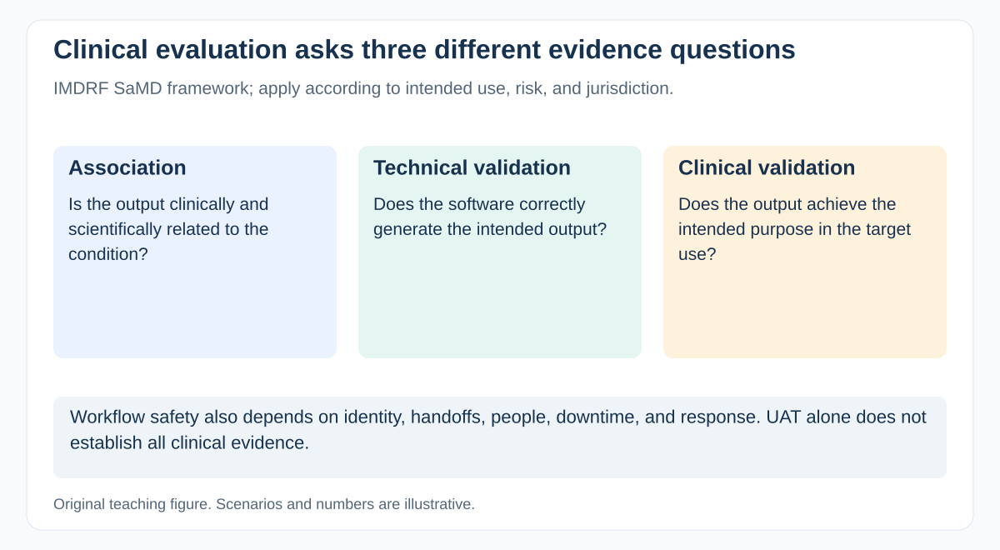

[Explanation and sources](../answers/healthcare/clinical-validation.md)

### A card payment has several distinct states

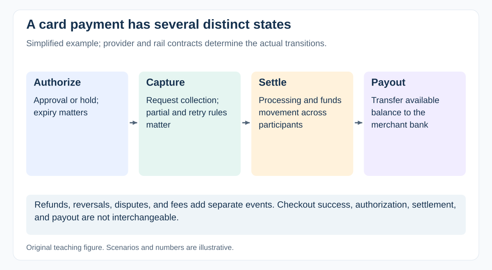

[Explanation and sources](../answers/fintech/payment-lifecycle.md)

### Reconciliation compares independent records

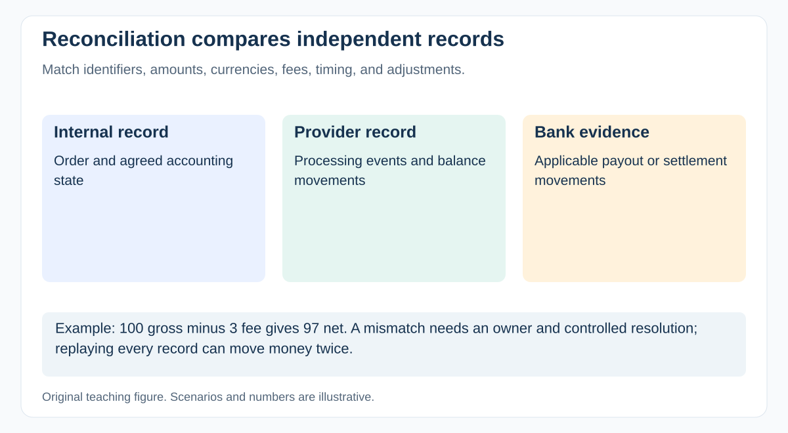

[Explanation and sources](../answers/fintech/financial-correctness.md)

### Severity is one input to vulnerability prioritization

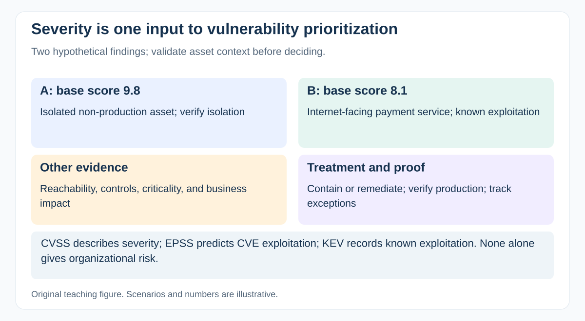

[Explanation and sources](../answers/cybersecurity/vulnerability-prioritization.md)

### SOC capability is a tested detection-to-response chain

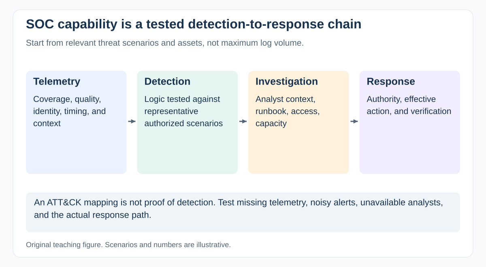

[Explanation and sources](../answers/cybersecurity/soc-siem-delivery.md)
